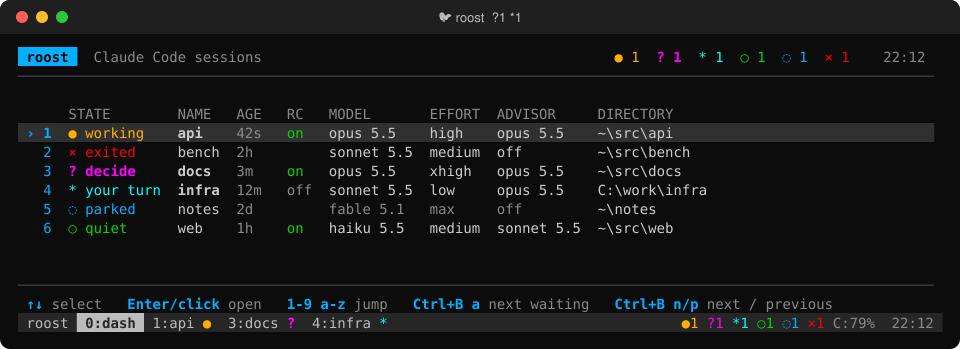
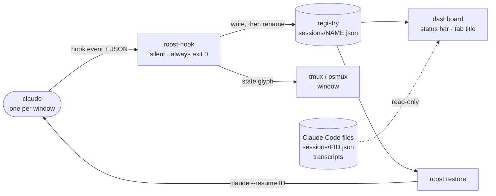
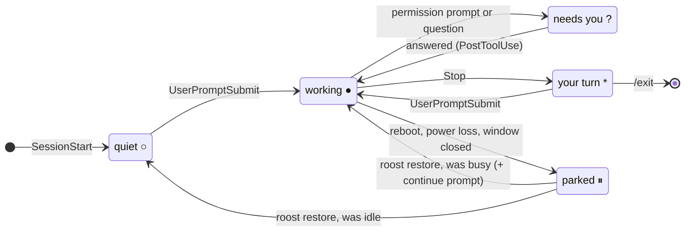

# roost

**A home for your Claude Code sessions.** roost runs every [Claude Code](https://claude.com/claude-code) session in its
own window of a terminal multiplexer, reads each one's live state from Claude Code's hook events, and brings all of them
back, resumed where they stopped, after a reboot, a power cut or a dropped SSH / RDP connection.

[Install](#quick-start) · [How it works](#how-it-works) · [Commands](#commands) · [FAQ](#faq) · [For AI agents](#for-ai-agents)

[](LICENSE)




> roost is an independent community project. It is not made by or affiliated with Anthropic.

## Why

Agent sessions are long-lived, but the terminal that hosts them is not. Close a tab, lose Wi-Fi or reboot for an update,
and the context of a dozen sessions is scattered across transcripts you have to find and resume by hand. And while they
run, the one that is blocked on a permission prompt looks exactly like the ones that are working.

roost fixes both: sessions live in tmux (Linux) or [psmux](https://github.com/psmux/psmux) (Windows), a registry fed by
Claude Code hooks knows the state and id of every session, and one command (or the boot itself) puts them all back.

## Highlights

- **Know which session needs you.** Every window carries its state, from `●` working to `?` blocked on a decision to
  `*` finished and waiting for your next message. The status bar lists only the sessions that need you, and the terminal
  tab says `🐦 roost  ?1 *2`. `Ctrl+B a` jumps to the next one: decisions first, then the ones waiting for you.
- **Survive closed terminals, dropped connections and reboots.** Close the terminal or drop SSH and the sessions keep running. After a
  reboot or a power cut, roost reopens each one with `claude --resume <id>`. Linux does it from systemd before anyone
  logs in, Windows at sign-in. Sessions interrupted mid-task get a short "continue where you stopped" prompt; idle ones
  just reopen.
- **Restore exactly what you had.** The permission mode and the claude.ai connector setting of each session come back
  with it. `bypassPermissions` is never restored automatically.
- **See what each session is running.** A Remote Control column shows which sessions you can reach from another device.
  On Windows, MODEL, EFFORT and ADVISOR columns show what each session last ran with, including mid-session `/model`,
  `/effort` and `/advisor` changes.
- **Stay out of the way.** roost never passes `--model` or effort flags and never edits your Claude Code settings beyond
  one `hooks` section, written once, with a backup. The hooks print nothing, always exit 0, and do nothing in sessions
  roost did not start.
- **Run on plain shell.** bash and PowerShell, tmux and psmux, `jq` on Linux. No daemon, no service of its own on
  Windows, nothing downloaded at install time.

| | Linux | Windows |
|---|:-:|:-:|
| Sessions survive closing the terminal, SSH / RDP drops | ✓ | ✓ |
| Live state per session from Claude Code hooks | ✓ | ✓ |
| Status bar with only the sessions that need you, tab title with counts | ✓ | ✓ |
| Jump to the next waiting session (`roost next`, `Ctrl+B a`) | ✓ | ✓ |
| Resume after reboot / power loss with `claude --resume` | ✓ before login (systemd) | ✓ at sign-in |
| Continue prompt only for interrupted sessions, crash-loop guard | ✓ | ✓ |
| Permission mode and connectors restored | ✓ | ✓ |
| Remote Control column | ✓ | ✓ |
| Model, effort and advisor columns | | ✓ |
| Dashboard | `watch`-style list, click to jump | interactive: click, arrows, keys, wheel |
| Detects a claude that exited and leaves its window as a plain shell | ✓ `SHELL` | ✓ `✗ exited` |
| Self-test, health check, uninstaller | ✓ | ✓ |

## How it works



**Hooks.** Claude Code calls `roost-hook` on `SessionStart`, `UserPromptSubmit`, `Stop`, `Notification`, `PostToolUse` and
`SessionEnd`. The hook writes one small JSON file per session (name, directory, session id, transcript, state, permission
mode, connectors) by write-then-rename, so a reader never sees half a file, and it puts the state glyph on the window.
`PostToolUse` fires after every tool call, so on Windows it runs asynchronously behind a 30 ms check and starts
PowerShell only while the session shows `?`.



**Two state values.** `state` (busy or idle) decides whether a restored session gets the continue prompt. The display
state (working, needs you, your turn, quiet) drives the glyphs. A permission prompt changes only the display, so a
session that was working when the power went out still counts as interrupted.

**Liveness without guesswork.** A session counts as open only while claude really runs in its window. Linux asks tmux
what the pane runs. Windows matches the window's process id *and* its start time, so a reused PID is never mistaken for
a running session. Only `/exit` or `/logout` forgets a session; everything else leaves it parked for restore.

**Restore pipeline** (`roost restore --boot` on Linux, the Startup entry on Windows):

1. Wait until `api.anthropic.com` answers, so sessions do not resume into a dead network.
2. Crash-loop guard: after three boots within 30 minutes, sessions are resumed without the continue prompt, so a machine
   that keeps crashing does not keep re-running the task that crashed it.
3. Reopen every parked or exited session with `claude --resume <id>`, its permission mode and connectors, staggered a few
   seconds apart.
4. Append the continue prompt only for sessions whose registry state is busy.

**What roost reads from Claude Code**, always read-only and failing soft (an empty cell, never an error):
- Hook payloads: session id, transcript path, permission mode, notification type.
- `~/.claude/sessions/<pid>.json`: Remote Control. `bridgeSessionId` is set while a session is connected; pid and
  process start time are matched, and a session handed to a background job follows the job's process.
- The end of each transcript (Windows): `message.model`, `effort` and `advisorModel` of the last main-thread assistant
  entry, read from the last 64 KB and cached until the file changes. Hooks carry no advisor and the model only on some
  starts; the transcript has all three.

## Quick start

### Linux

Needs `tmux` 3.2+, `jq` and `claude`. Tested on Ubuntu 24.04 with tmux 3.4.

```bash
git clone https://github.com/ExpectedArgument/roost && cd roost/linux
./install.sh              # command + hooks + tmux config
./install.sh --systemd    # also: start at boot and resume after power loss, before login (sudo; takes over at the next boot if tmux already runs)
roost new api ~/src/api   # first session (add -c to continue the last chat in that directory)
roost                     # dashboard;  Ctrl-b a  next waiting;  Ctrl-b w  all sessions;  Ctrl-b d  detach
roost doctor ; roost selftest
```

Remote: `ssh -t HOST roost`. Optional hard-stall recovery (hardware watchdog, panic reboot, NVMe power-state
workaround) lives in [`linux/extras/recovery`](linux/extras/recovery); it is hardware specific and off by default.

### Windows

Needs PowerShell 7, `claude` and [psmux](https://github.com/psmux/psmux) (`winget install psmux --version 3.4.0`; verify the
hash on the release page). Best in Windows Terminal. The Windows port is newer than the Linux one; please report problems.

```powershell
git clone https://github.com/ExpectedArgument/roost; cd roost
pwsh -File windows\install.ps1     # scripts, hooks, sign-in restore, `roost` command, Windows Terminal profile
roost selftest ; roost doctor
roost new api C:\src\api
roost                              # dashboard: click, arrows + Enter or a session's key;  Ctrl+B a  next waiting;  Ctrl+B d  detach
```

`install.ps1` also adds a **roost** profile with the 🐦 icon to the Windows Terminal new-tab menu. Sessions reopen when
you sign in (Startup folder, no admin rights). Windows has no boot service without a sign-in unless you enable auto
sign-in yourself.

## Commands

| Command | |
|---|---|
| `roost` | open the dashboard (attach to the multiplexer session) |
| `roost new NAME [DIR] [claude args]` | start a session; extra args go to claude (`-c`, `--model sonnet`, …). DIR defaults to `$ROOST_PROJECT_ROOT/NAME` when it exists. `--connectors` keeps claude.ai connectors on |
| `roost NAME` | switch to a session (Windows: reopens it first if it is parked or exited) |
| `roost ls` | list sessions with state, age, RC (and model, effort, advisor on Windows) |
| `roost restore [NAME]` | reopen parked and exited sessions |
| `roost next` | jump to the next session that waits for you (`?` first, then `*`); bound to `Ctrl+B a` |
| `roost close NAME` | `/exit` the session cleanly, close its window, forget it |
| `roost forget NAME` | drop the registry entry only |
| `roost adopt NAME` | Linux: register a tmux window where claude already runs |
| `roost doctor` | health check: tools, hooks, restore at boot / sign-in |
| `roost selftest` | test the scripts against a throw-away setup, touching no real session |

## Configuration

| | Linux | Windows |
|---|---|---|
| default claude flags | `~/.config/roost/claude-flags` (`--permission-mode auto`) | `%LOCALAPPDATA%\roost\config\claude-flags` |
| continue prompt | `~/.config/roost/resume-prompt.txt` | `…\config\resume-prompt.txt` |
| sessions that keep claude.ai connectors (or `*`) | `~/.config/roost/connectors-allow` | `…\config\connectors-allow` |
| state and registry | `~/.local/state/roost` | `%LOCALAPPDATA%\roost` |

Sessions not listed in `connectors-allow` start with `ENABLE_CLAUDEAI_MCP_SERVERS=false`, which saves tokens when you do
not need them. The default is `*`, so nothing changes until you edit it.

Environment: `ROOST_PROJECT_ROOT`, `ROOST_AUTOCONTINUE=0` (never send the continue prompt), `ROOST_CLAUDE_BIN`,
`ROOST_STAGGER`, `ROOST_NET_WAIT`, and on Windows `ROOST_MOUSE=0` (the dashboard leaves the mouse alone).

## Guarantees

- **Your settings stay yours.** The installers add one `hooks` section to `~/.claude/settings.json` after backing it up,
  detect existing entries and leave the file untouched when nothing is missing. `model`, `effortLevel` and everything
  else are never written.
- **Hooks cannot hurt a session.** They print nothing (hook output would reach the model's context), always exit 0,
  never block on anything and ignore sessions roost did not start.
- **Nothing is assumed about Claude Code internals.** Its per-process files and transcripts are undocumented, so every
  read is defensive: a missing file or field means an empty cell, never a failed command.
- **No surprises with permissions.** A restored session gets back its own permission mode, except `bypassPermissions`,
  which is never restored automatically. On Windows, `roost close` sends Esc before `/exit`, so a pending permission
  prompt is cancelled, never answered.
- **No telemetry, no daemon.** The only network access is the reachability check before a boot-time restore.

## Testing

```text
linux/bin/roost selftest                         # own tmux socket, state dir and a fake claude: new, hooks, ls, title, next, restore, SHELL, close, RC
pwsh -File windows\roost.ps1 selftest            # temp home, dry-run psmux, roost-run.ps1 with a fake claude: hooks, restore, run, next, transcripts, RC
pwsh -File windows\probe-statusbar.ps1 -Click …  # renders the psmux status bar through a pseudoconsole and clicks its labels
```

Tested on Ubuntu 24.04 with tmux 3.4, and on Windows 11 with PowerShell 7.6, psmux 3.4.0 and Windows Terminal 1.24.

## FAQ

**What happens when the machine reboots or loses power?**
Every registered session is parked. On Linux with `--systemd`, the tmux server and the restore unit start at boot, before
anyone logs in. On Windows, restore runs when you sign in. Each session comes back with `claude --resume`, in its own
directory, with its permission mode. Those that were working get the continue prompt.

**Does roost change my Claude Code configuration?**
Only the `hooks` section, once, with a backup. Model, effort, advisor, permissions and every other setting are left
alone. Extra flags you give `roost new` are passed to claude unchanged.

**A session shows `✗ exited` or `SHELL`. What happened?**
claude quit, for example after a crash or a Ctrl+C, and its window stayed open as a plain shell. `roost restore NAME`
resumes it in a fresh window. On Windows, picking it on the dashboard or `roost NAME` does the same.

**Does it work remotely?**
Yes. Detach, disconnect, come back: `ssh -t HOST roost` on Linux. On Windows, sessions survive a dropped Remote Desktop
connection. With Claude Code's Remote Control, the RC column shows which sessions you can reach from another device.

**Why psmux on Windows?**
It is a native tmux-compatible multiplexer for Windows, so sessions run in real Windows processes, with no WSL. roost
works around a few psmux 3.4.0 quirks, documented in [`windows/CLAUDE.md`](windows/CLAUDE.md).

**How do I remove it?**
`linux/uninstall.sh`, or `pwsh -File windows\uninstall.ps1 [-DryRun]`. Both back up `settings.json` and remove only
roost's hook entries. Your conversations are never touched.

## For AI agents

Read [`CLAUDE.md`](CLAUDE.md) first (shared design: hook events, state values, registry, invariants), then
[`linux/CLAUDE.md`](linux/CLAUDE.md) or [`windows/CLAUDE.md`](windows/CLAUDE.md) for the port you change. Mirror a
behaviour change in both ports unless it is platform specific. Never test against the user's live multiplexer session:
both self-tests and the recipes in the port notes use throw-away sessions, homes and a fake claude.

## License

MIT
